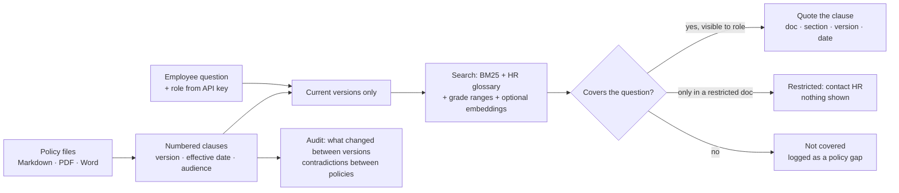

# Clausewise


**An HR and policy helpdesk that answers employees from your own policies, quoting the exact clause. When the policy is silent it says so, and it never shows a document to the wrong role.**

Employees ask the same questions every day: how many casual leaves, the hotel limit in Mumbai, the notice period for G5, whether a POSH complaint stays confidential. Clausewise answers from the company's own policy library, quoting the current clause word for word with document, section, version and effective date. If no policy covers the question, it says so and logs it for HR. If the answer is in an HR-only document, it says the question is restricted, without showing any of it. HR gets a report of what employees asked that no policy covers, and a list of contradictions between policies.

## Results

`python -m clausewise.evaluate` asks questions about a sample policy library for a fictional retailer: 10 documents including an old and a new leave policy, an HR-only salary-band file and a managers-only appraisal guide. Each question has a known right answer: a value in a specific current clause, "not covered", or "restricted for this role".

| Questions answered right | Dev (51) | Held-out 1 (38) | Held-out 2 (41) | HR-only content leaked | Outdated version used |
|---|---|---|---|---|---|
| Typical RAG (fixed chunks, best match) | 65% | 39% | 63% | 5 / 8 / 3 | 7 / 6 / 2 |
| **Clausewise**, keyword search | **98%** | 76% | 63% | **0 / 0 / 0** | **0 / 0 / 0** |
| **Clausewise** + embeddings (CI) | **98%** | **82%** | **68%** | **0 / 0 / 0** | **0 / 0 / 0** |

Both held-out sets use wording, Hinglish ("kitni PL milti hai") and city names ("hotel budget in Mumbai") that never appear in the dev questions. With keyword search, across every set Clausewise answered "not covered" correctly for all 15 out-of-policy questions, gave "restricted" correctly for all 7 HR- or manager-only questions, and never leaked or used a superseded policy. The typical RAG never refuses, leaked HR-only content 16 times and quoted the old leave policy 15 times. The policy audit finds 3/3 numbers that changed between leave policy versions and the 1 planted contradiction (12 vs 10 fixed holidays), with no false alarms.

### How the benchmark kept me honest

| Round | What happened | What changed |
|---|---|---|
| 1 | Dev 86%: 7 real questions refused because words like "deadline", "minimum", "how long" counted as meaning the policy lacked | Words that describe the *kind* of answer wanted no longer count against coverage |
| 2 | Held-out 1, first run: **61%**, 14 real questions refused. "new mothers" matched maternity in the glossary, yet "new" and "mothers" still counted as unknown words | A glossary phrase now replaces its words in the question; the clause covering most of the question wins |
| 3 | Held-out 1 was now seen, so a new held-out 2 was written **before** running the fixed version: **63%**, the same as the typical RAG overall, but with all refusals and restrictions right and zero leaks; it still refused 15 of 34 real questions in new wording | Keyword search alone cannot handle free wording |
| 4 | Embeddings (all-MiniLM-L6-v2) added behind the same gates; the confidence threshold is picked on dev only, then both held-out sets are scored once in CI | 82% and 68%, still zero leaks and zero outdated answers |

The remaining misses are honest refusals ("not covered" when a clause did exist), not wrong answers. A wrong answer about a policy is worse than an "ask HR".

## Who buys it and how it is sold

| | |
|---|---|
| **Buyers** | HR teams at companies with 200 to 5,000 employees: retail, IT services, manufacturing, BPO; HR outsourcing and payroll firms serving many clients |
| **Their pain** | HR answers the same leave, travel and exit questions all day; policies change and old PDFs keep circulating; general chatbots invent answers and cannot be trusted with salary bands or appraisal guidelines |
| **What they get** | Verbatim answers with citations, honest refusals, role-based access, the latest version automatically, a policy-gap report and a contradiction audit |
| **Trust** | Runs on the company's own server; roles come from API keys, not from what the user types; optional AI phrasing is discarded if it contains a number not in the clause |
| **Fits in** | REST API for Slack, Microsoft Teams, WhatsApp or the intranet; Streamlit dashboard for HR |

**ROI example** (illustrative): an HR team of 4 spending 2 hours a day each on repeat policy questions, at ₹600 an hour, costs **about ₹1.0 lakh a month**. If Clausewise answers 60% of those questions, that is roughly ₹60,000 a month back for hiring, engagement and compliance work. Fewer wrong answers about leave, notice periods or POSH also means fewer disputes.

| Plan (suggested) | For | Price idea |
|---|---|---|
| Team | Up to 300 employees | ₹4,999 per month |
| Business | Up to 2,000 employees | ₹14,999 per month, Slack or Teams bot, gap report |
| Enterprise | Larger, multi-entity | Annual licence, on-premise, SSO roles, custom glossary |

**Pilot plan (3 weeks):** load the client's current policies, collect 50 real questions from their HR inbox, and compare Clausewise's answers with what HR actually replied. The client sees accuracy, refusals and the contradictions found in their own policy library before any employee uses it.

## How it works



| Design choice | Why |
|---|---|
| Quote the clause, do not paraphrase | An employee and HR must be able to point at the exact rule; a paraphrase can change its meaning |
| Search the whole clause plus its title and section | "Leave entitlement" and "Travel and Expense Policy" carry meaning a 350-character chunk loses |
| HR glossary built in | PL, EL, annual leave and "chhutti" are the same thing; Mumbai is a metro; "G4 to G6" includes G5 |
| Refuse below a coverage threshold | "Not covered, ask HR" costs a minute; a confident wrong answer about leave or notice costs trust |
| Restricted documents are searched only to say "restricted" | The employee learns to ask HR; not a word of the salary bands is shown |
| Effective dates decide the version | The old leave policy keeps circulating; only the version in force on the date asked is used |
| Roles from API keys | A user cannot type "role: hr" and read salary bands |

## Use it

```bash
pip install -e ".[app]" && streamlit run app.py          # dashboard on the sample library
pip install -e .
clausewise ask "how many casual leaves do I get?"
clausewise ask "salary band for G5" --role employee      # -> restricted
clausewise audit                                         # changes and contradictions
clausewise --policies ./my_policies ask "notice period for G4"
docker compose up -d                                     # API :8000 + dashboard :8501
```

| Endpoint | What it does |
|---|---|
| `POST /v1/ask` | `{"question": "...", "as_of": "2025-11-01"}` → status (answered, restricted, not covered), quoted clauses, citation labels, version note |
| `GET /v1/gaps` | HR only: unanswered topics with counts and examples |
| `GET /v1/audit` | HR only: what changed between versions, contradictions between current policies |

**Your own policies:** Markdown files with front matter (`title`, `policy_id`, `version`, `effective`, `audience`), or PDF and Word files described in a `policies.yaml` manifest. Numbered clauses (`2.1`, `3.4.2`) are kept as citable units; unnumbered paragraphs also work.

**Optional:** `CLAUSEWISE_SEMANTIC=1` with `pip install "clausewise[semantic]"` for embeddings; `CLAUSEWISE_LLM=groq` (or gemini, ollama) to phrase answers in plain words, discarded if they contain a number the clause does not.

## Limitations

- The policy library and questions are a realistic sample, not a client's data; the pilot measures it on real questions.
- With embeddings, held-out 2 is still 68%: the errors are refusals of real questions in unusual wording. The threshold was picked as the most cautious value tried, because keyword search already gets dev at 98%; a client's own question log is the right place to tune it.
- When two clauses cover a question equally well, the stronger keyword match wins, which is occasionally the wrong one.
- Answers are only as good as the policies: the gap and contradiction reports are there to fix the source.
- Not legal advice; statutory questions (POSH, gratuity, maternity) are answered from the company's policy text only.

## Project layout

```
src/clausewise/corpus.py      policy files -> clauses with version, date and audience
src/clausewise/search.py      BM25 + HR glossary + grade ranges + character n-grams
src/clausewise/semantic.py    optional sentence embeddings
src/clausewise/desk.py        answer / restricted / not covered, citations, gap log
src/clausewise/conflicts.py   version changes and contradictions
src/clausewise/llm.py         optional plain-words phrasing, number-checked
src/clausewise/evaluate.py    benchmark vs typical RAG, dev + two held-out sets
src/clausewise/sample_policies/  10 sample documents for a fictional retailer
src/clausewise/api.py         FastAPI, roles from API keys
app.py                        Streamlit dashboard for HR
```
